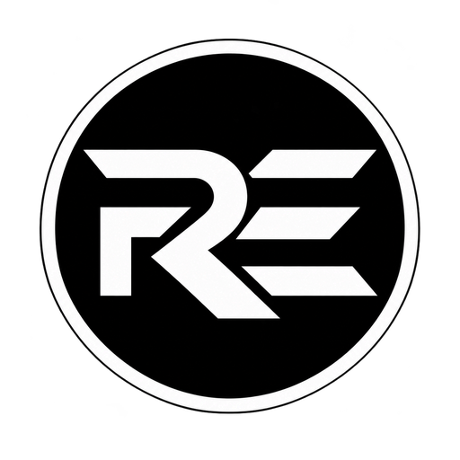
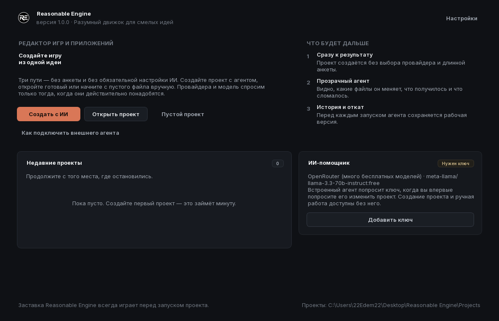
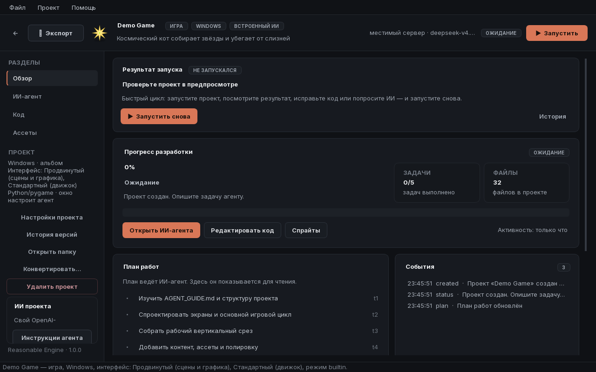
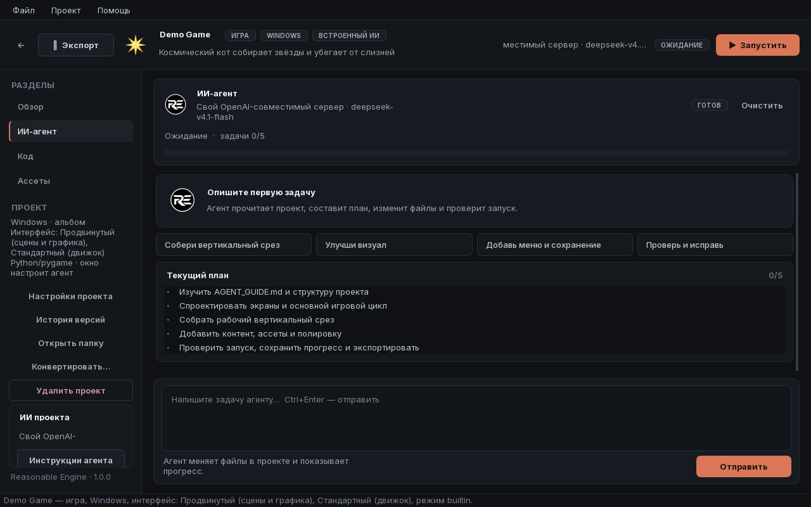
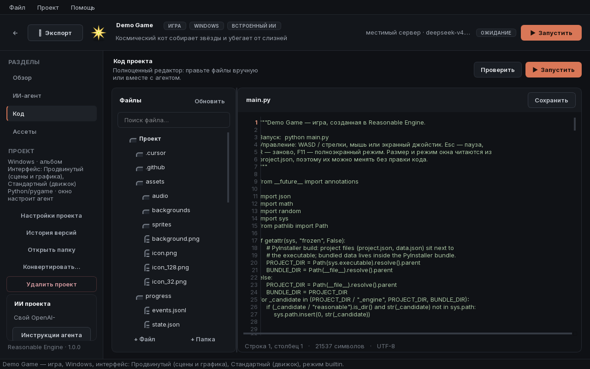

  

<h1 align="center">Reasonable Engine 2</h1>

  <b>The reasonable engine for bold ideas.</b> 
  A game and application editor with an AI agent that doesn't just advise — it works:
  writes code, generates sprites, keeps the plan on track, and carries your project
  all the way to launch.

  <b>Released version: RE-2.01</b> · RE-2.02 has not started yet (in development)

  🌐 English · <a href="README.ru.md">Русский</a>

  <a href="#-download">Download</a> ·
  <a href="#-features">Features</a> ·
  <a href="docs/getting-started.md">Getting Started</a> ·
  <a href="docs/faq.md">FAQ</a> ·
  <a href="CHANGELOG.md">Changelog</a>

---

> **Closed source.** This repository is the public home of Reasonable Engine:
> documentation, releases, and feedback. The editor itself is distributed as a
> ready-made installer; the source code is not published (see [LICENSE.txt](LICENSE.txt)).

## 📥 Download

The current build is always here: **[Releases](../../releases/latest)** — download
`ReasonableEngine-Setup-RE-2.01.exe`, run it, and get to work. Installation is simple:
the engine places the editor, a portable Python, and the runtime itself; there is
nothing extra to configure. Your projects are stored in the `Projects` folder inside
the installation and are not removed on update.

> **Current release — RE-2.01** (released November 4, 2026). Everything described
> below is already part of this released version. **RE-2.02 has not started yet** —
> it is in development, so its changelog section is still empty.

| | |
|---|---|
| Platforms | Windows 10/11 (x64), export to Android |
| UI language | Russian |
| Installer size | ~165 MB |
| License | Proprietary, free to use ([LICENSE.txt](LICENSE.txt)) |

## ✨ Features

### An AI agent that carries things to the result
- Describe the task in plain words — the agent will study the project, draw up a
  plan, execute it step by step, and **verify the launch itself** after every major
  milestone.
- No step limit: the agent works until there is a result, not until "sorry, the
  steps have run out".
- Conversation history is kept per project together with the agent's answers —
  come back a week later and see the whole conversation, not only your own
  messages.
- Live progress: the task plan, completion percentage, and event feed update in
  real time.
- **Independent task check**: before the final answer a separate pass compares
  the user's exact request with the code, validation and run result. If anything
  is missing, the agent keeps working instead of declaring success.
- **Parallel development**: a master agent plans and controls while code and
  asset specialists work simultaneously in disjoint files. The master then
  verifies the launch, audits the result and dispatches fixes.
- **UI language = agent language**: Russian or English chosen in settings is used
  for plans, progress and replies even when the task is written in another
  language.
- **Interactive first-launch tutorial**: six hands-on steps ask you to create a
  project, give the agent a task, visit the workspaces, run it, undo changes and
  choose an export. The next step unlocks only after the action. Replay it from
  Help → Quick start, the settings dialog, or the Tutorial button on the start
  screen.

### Interface levels
When creating a project, pick one or more levels — the project receives only the
tools and templates it needs, with nothing extra:

| Level | What it's for | Technology |
|---|---|---|
| **Simple** | Utilities, forms, lists, workhorse apps | tkinter, plain Windows windows |
| **Standard** | Apps and game menus: panels, lists, scrolling, tabs | Ready-made engine widgets |
| **Advanced** | Games and rich graphics: scenes, camera, particles, animations | Custom renderer on pygame |

### Real examples, not empty stubs
- **Game**: a title menu, a how-to-play screen, enemy waves, a combo multiplier,
  an invulnerable dash, four power-ups, procedural sound, a saved high score and a
  results screen. Controls work with mouse, keyboard and an on-screen joystick.
  Its starter scene opens in the editor, and markers there define where the
  player, stars and slimes spawn.
- **App**: a genuine planner with priorities, tags, search, sorting, weekly
  statistics, a day streak, undo-delete and a context-aware AI assistant. Data
  lives in a plain `data.json` next to the project.
- Both examples run the moment the project is created and are a working base:
  keep building on them yourself or hand them to the agent as a starting point.

### Assets without a designer
The agent draws any sprite itself — from a pixel grid or vector primitives chosen
for that object — or uses your own image model when one is configured. There is
no generic "default character" template.

### Scene editor
- **Place objects with the mouse**: a grid canvas with snapping, rectangles,
  circles, text, panels and images from assets; drag out a shape, resize it by
  handles and zoom with the wheel.
- **Multiple scenes**: tabs, creating an empty scene, a level, a menu or an app
  screen, duplicating, renaming, deleting, and size/background/grid settings.
  Apps immediately get a ready screen layout.
- **Inspector right beside it**: position, size, rotation, layer, colour and
  visibility for every object — no hand-editing JSON.
- **The scene goes straight into the game**: the saved `scenes/main.json` is
  loaded by the `add_scene_objects` call, so the layout from the editor reaches
  the running project. In the starter game markers define where the player, stars
  and slimes appear.

### Export
- **Windows folder** — a self-contained folder with `Play.bat` and the engine built in.
- **Windows .exe** — a single executable with the icon and the name you choose.
- **Android package** — a ready `buildozer.spec`, instructions, and even a GitHub
  Actions workflow, so you can build the APK right in the cloud.
- Export goes to the **Desktop** by default, and every build stage has its own
  progress bar.

### Splash screen
Every product created in Reasonable Engine opens with the signature minimalist
splash (like Unity or Godot): a dark screen, the logo, a second and a half. It is
part of the engine and cannot be disabled: `splash=False` is ignored, and the
editor/player show it before project code runs. The splash displays the current
generation — **Reasonable Engine 2**.

## 🖼 Screenshots

| Welcome | Project overview |
|---|---|
|  |  |

| AI agent | Code |
|---|---|
|  |  |

*Splash screen: [splash.png](assets/screenshots/splash.png) · logo: [assets/brand](assets/brand)*

## 🔢 Versioning System

Reasonable Engine uses **two-level** numbering:

- **Generation** — the engine's global version: *Reasonable Engine 2* (short for
  **RE 2**). It changes only when the engine undergoes a global shift: a new
  architecture, a new project format, backward-incompatible changes.
- **Release** — a specific build within a generation: **RE-2.01**, **RE-2.02**,
  **RE-2.03**…

Rules:

1. Releases within a generation are numbered **starting with .01**: the first
   release of a generation is RE-2.01, then RE-2.02, and so on. A version like
   "RE-2.00" **does not exist**.
2. Numbers go in order and never skip: after RE-2.09 comes RE-2.10, and after
   RE-2.99 comes RE-2.100.
3. When moving to a new generation, the count starts over: Reasonable Engine 3
   begins with RE-3.01, then RE-3.02…RE-3.12, and so on.
4. A generation never "rolls back": Reasonable Engine 2 cannot ship an RE-1.xx
   release, and RE 1 cannot ship an RE-2.xx release.
5. The current **released** version is **RE-2.01**; the next version, **RE-2.02,
   has not started yet** and is in development. The live status is always shown in
   the header of [CHANGELOG.md](CHANGELOG.md) and in the editor's "About" window.

## 🖥 System Requirements

- Windows 10/11 (x64); building Android packages additionally requires Linux/WSL2 or GitHub Actions
- 4 GB RAM (8 GB for comfortable AI agent work)
- ~700 MB of disk space for the installation + room for projects
- A GPU with OpenGL 2.1 support (any from the last 15 years)
- The internet is only needed for cloud AI providers and downloading the installer;
  agent-drawn sprites and local models work offline

## 📚 Documentation

| Document | What it covers |
|---|---|
| [Getting Started](docs/getting-started.md) | Installation, first project, first launch |
| [AI Agent](docs/agent.md) | Tasks, plan, progress, history, external agent |
| [Export](docs/export.md) | Windows folder, .exe, Android |
| [FAQ](docs/faq.md) | Frequently asked questions and answers |

## 🤝 Contributing

The project is closed, but ideas and bug reports are the fuel of its development:
see [CONTRIBUTING.md](CONTRIBUTING.md). Templates are in the Issues section.

## 📄 License

Proprietary license: [LICENSE.txt](LICENSE.txt). In short: you may use the engine
and create with it freely and free of charge, including for commercial projects;
the source code stays closed, and the splash screen and branding are part of the engine.

© 2026 The Reasonable Engine copyright holder. All rights reserved.
