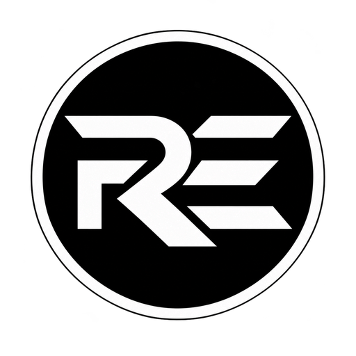
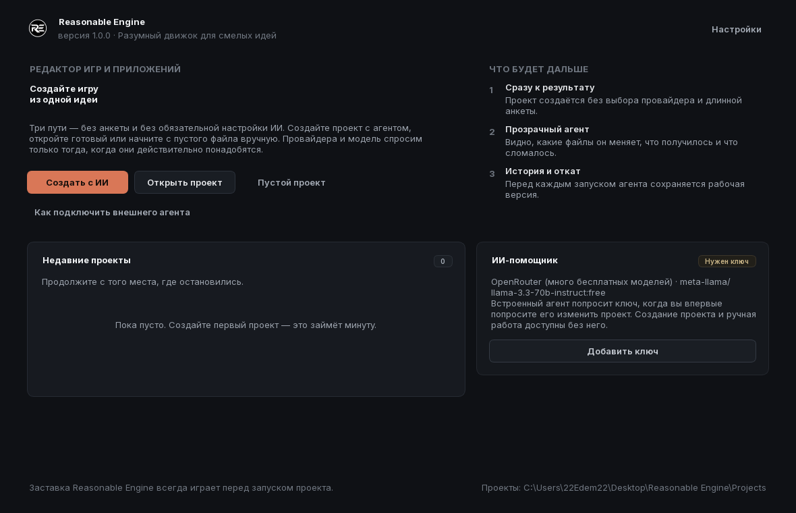
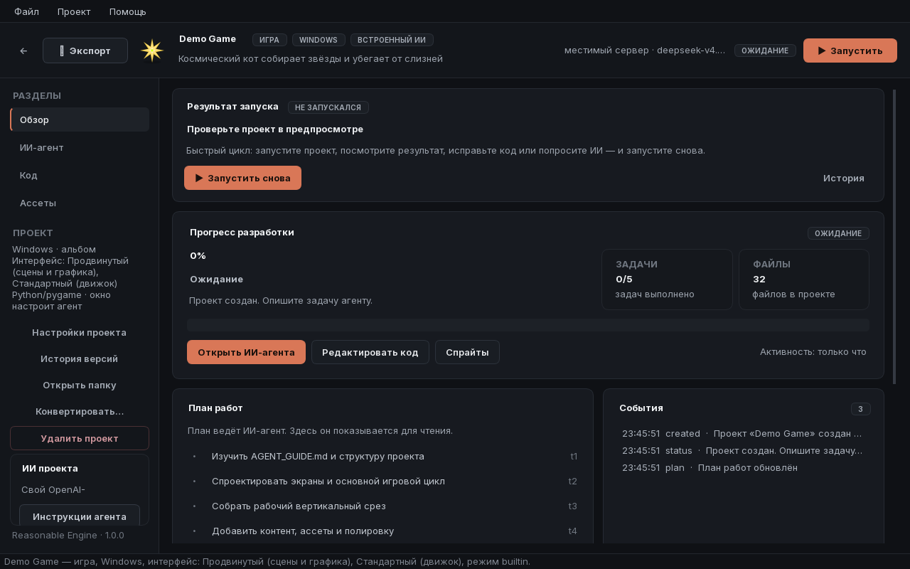
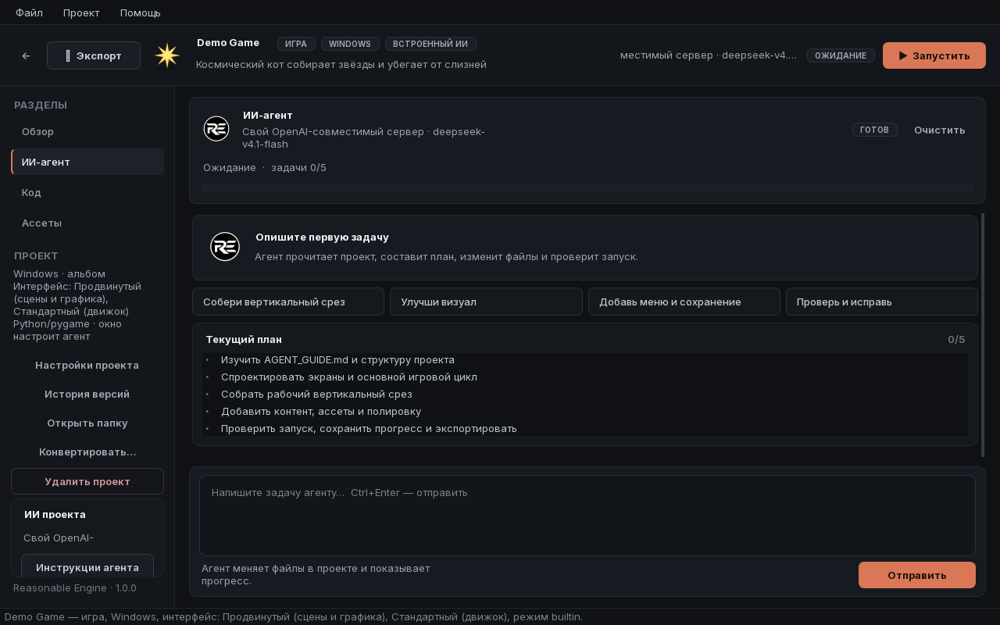
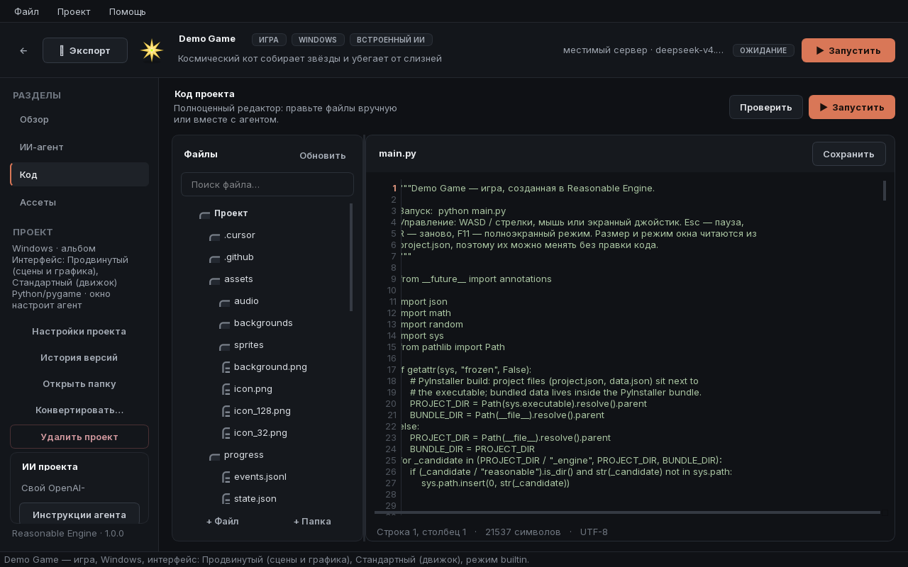

  

<h1 align="center">Reasonable Engine 1</h1>

  <b>Разумный движок для смелых идей.</b> 
  Редактор игр и приложений с ИИ-агентом, который не подсказывает, а работает —
  пишет код, генерирует спрайты, ведёт план и доводит проект до запуска.

  🌐 <a href="README.md">English</a> · Русский

  <a href="#-скачивание">Скачать</a> ·
  <a href="#-возможности">Возможности</a> ·
  <a href="docs/ru/getting-started.md">Начало работы</a> ·
  <a href="docs/ru/faq.md">FAQ</a> ·
  <a href="CHANGELOG.ru.md">Изменения</a>

---

> **Закрытый исходный код.** Этот репозиторий — публичный дом Reasonable Engine:
> документация, релизы и обратная связь. Сам редактор распространяется в виде
> готового установщика; исходный код не публикуется (см. [LICENSE.ru.txt](LICENSE.ru.txt)).

## 📥 Скачивание

Актуальная сборка всегда здесь: **[Releases](../../releases/latest)** — скачайте
`ReasonableEngine-Setup-RE-1.01.exe`, запустите и работайте. Установка простая:
движок сам размещает редактор, портативный Python и рантайм, ничего дополнительно
настраивать не нужно. Ваши проекты хранятся в папке `Projects` внутри установки и
не удаляются при обновлении.

| | |
|---|---|
| Платформы | Windows 10/11 (x64), экспорт на Android |
| Языки интерфейса | Русский |
| Размер установщика | ~165 МБ |
| Лицензия | Проприетарная, бесплатное использование ([LICENSE.ru.txt](LICENSE.ru.txt)) |

## ✨ Возможности

### ИИ-агент, который доводит до результата
- Опишите задачу обычными словами — агент изучит проект, составит план, будет
  выполнять его по шагам и **сам проверять запуск** после каждого крупного этапа.
- Без лимита шагов: агент работает до результата, а не до «извините, шаги кончились».
- История общения сохраняется по каждому проекту — можно вернуться через неделю
  и продолжить с того же места.
- Живой прогресс: план задач, процент готовности и лента событий обновляются в
  реальном времени.

### Уровни интерфейса
При создании проекта выберите один или несколько уровней — проект получит только
нужные инструменты и шаблоны, без лишнего:

| Уровень | Для чего | Технология |
|---|---|---|
| **Простой** | Утилиты, формы, списки, «рабочие лошадки» | tkinter, обычные окна Windows |
| **Стандартный** | Приложения и меню игр: панели, списки, прокрутка, вкладки | Готовые виджеты движка |
| **Продвинутый** | Игры и насыщенная графика: сцены, камера, частицы, анимации | Свой рендер на pygame |

### Ассеты без дизайнера
Генерация спрайтов, фонов и иконки проекта по текстовому описанию —
процедурно офлайн или через вашу модель изображений.

### Экспорт
- **Папка Windows** — самодостаточная папка с `Play.bat` и встроенным движком.
- **.exe для Windows** — один исполняемый файл с иконкой и именем, которое задаёте вы.
- **Android-пакет** — готовый `buildozer.spec`, инструкция, даже GitHub Actions
  workflow, чтобы собрать APK прямо в облаке.
- Экспорт по умолчанию идёт на **Рабочий стол**, каждый этап сборки виден
  отдельной шкалой прогресса.

### Заставка
Перед каждым продуктом, созданным в Reasonable Engine, играет фирменная
минималистичная заставка (как в Unity или Godot) — тёмный экран, логотип,
полторы секунды. Она — часть движка и отключению не подлежит.

## 🖼 Скриншоты

| Приветствие | Обзор проекта |
|---|---|
|  |  |

| ИИ-агент | Код |
|---|---|
|  |  |

*Заставка: [splash.png](assets/screenshots/splash.png) · логотип: [assets/brand](assets/brand)*

## 🔢 Система версий

Reasonable Engine использует **двухуровневую** нумерацию:

- **Поколение** — глобальная версия движка: *Reasonable Engine 1* (сокращённо
  **RE 1**). Меняется, только когда движок претерпевает глобальное изменение:
  новая архитектура, новый формат проектов, обратно несовместимые перемены.
- **Релиз** — конкретная сборка внутри поколения: **RE-1.01**, **RE-1.02**,
  **RE-1.03**…

Правила:

1. Релизы внутри поколения нумеруются **с .01**: первый релиз поколения —
   RE-1.01, затем RE-1.02 и так далее. Версии вида «RE-2.00» **не существует**.
2. Номера идут подряд и не перескакивают: после RE-1.09 будет RE-1.10,
   после RE-1.99 — RE-1.100.
3. При переходе к новому поколению счёт начинается заново: Reasonable Engine 2
   начинается с RE-2.01, дальше RE-2.02…RE-2.12 и т.д.
4. Поколение никогда не «откатывается»: Reasonable Engine 2 не может выпустить
   релиз RE-1.xx, а RE 1 — релиз RE-2.xx.
5. Текущий релиз указан в заголовке [CHANGELOG.ru.md](CHANGELOG.ru.md) и в окне
   «О программе» редактора.

## 🖥 Системные требования

- Windows 10/11 (x64); для сборки Android-пакетов дополнительно Linux/WSL2 или GitHub Actions
- 4 ГБ ОЗУ (8 ГБ для комфортной работы ИИ-агента)
- ~700 МБ на диске для установки + место под проекты
- Видеокарта с поддержкой OpenGL 2.1 (любая за последние 15 лет)
- Интернет нужен только для облачных ИИ-провайдеров и скачивания установщика;
  процедурные ассеты и локальные модели работают офлайн

## 📚 Документация

| Документ | О чём |
|---|---|
| [Начало работы](docs/ru/getting-started.md) | Установка, первый проект, первый запуск |
| [ИИ-агент](docs/ru/agent.md) | Задачи, план, прогресс, история, внешний агент |
| [Экспорт](docs/ru/export.md) | Папка Windows, .exe, Android |
| [FAQ](docs/ru/faq.md) | Частые вопросы и ответы |

## 🤝 Участие

Проект закрытый, но идеи и отчёты об ошибках — топливо развития: см.
[CONTRIBUTING.ru.md](CONTRIBUTING.ru.md). Шаблоны — в разделе Issues.

## 📄 Лицензия

Проприетарная лицензия: [LICENSE.ru.txt](LICENSE.ru.txt). Коротко: пользоваться и
создавать можно свободно и бесплатно, включая коммерческие проекты; исходный
код закрыт, заставка и фирменные элементы — часть движка.

© 2026 Правообладатель Reasonable Engine. Все права защищены.
